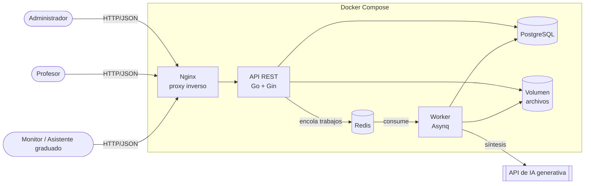
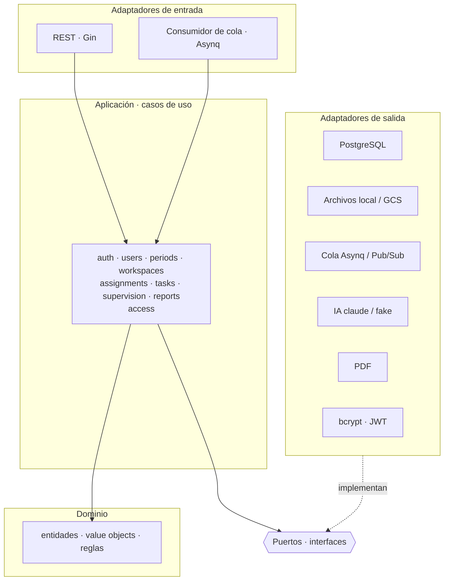
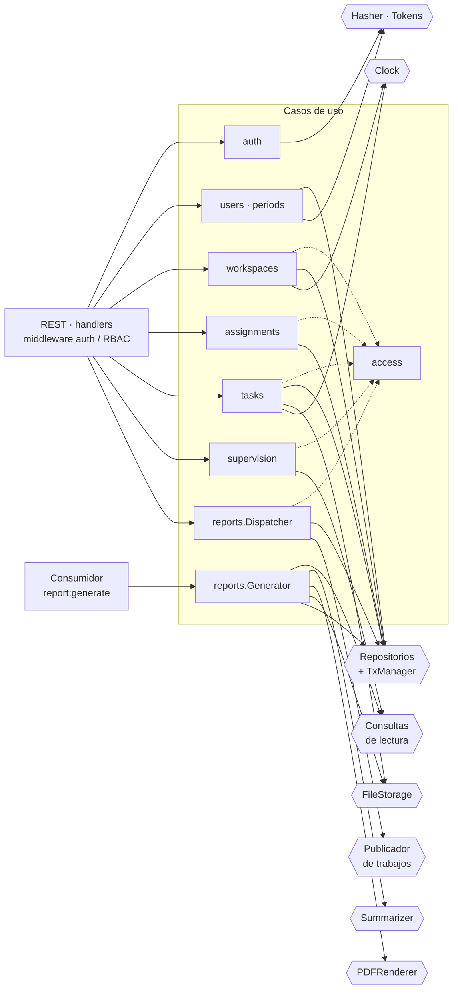
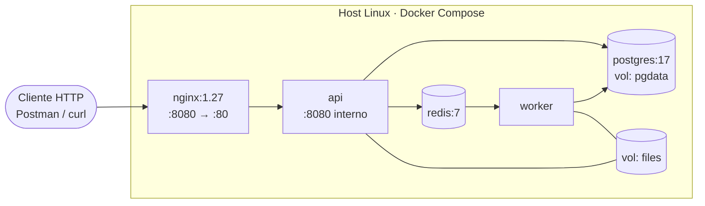
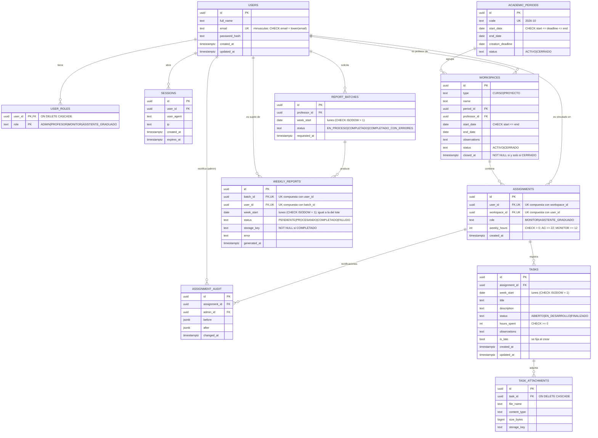
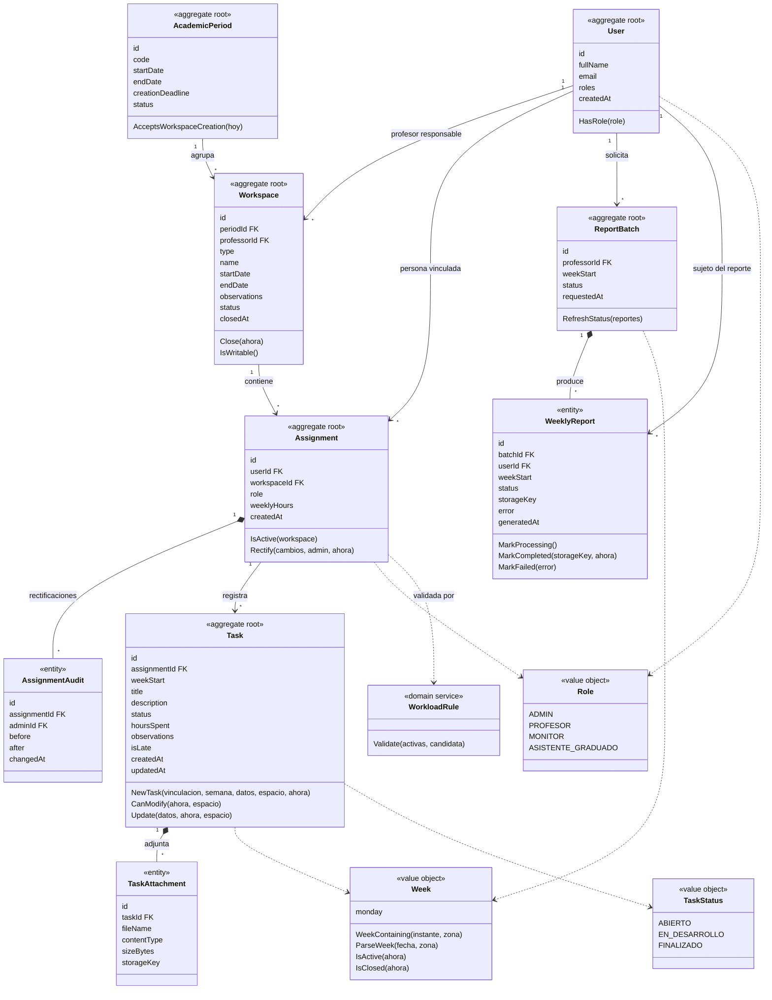
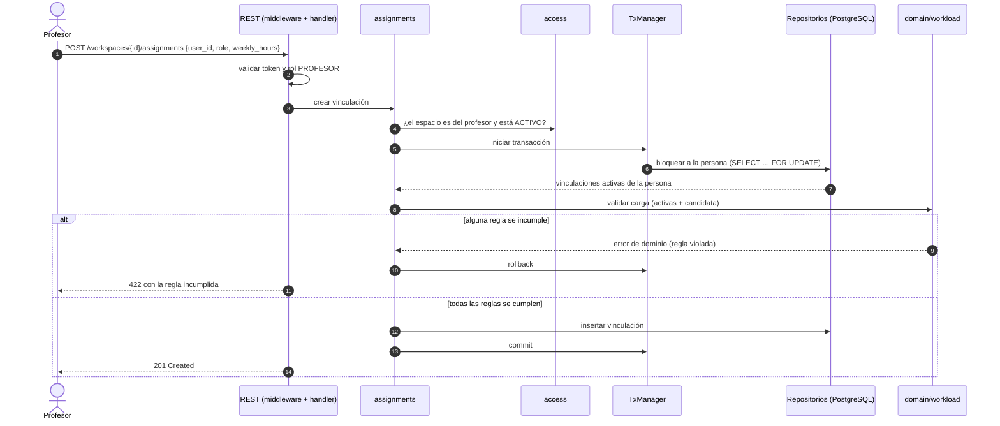
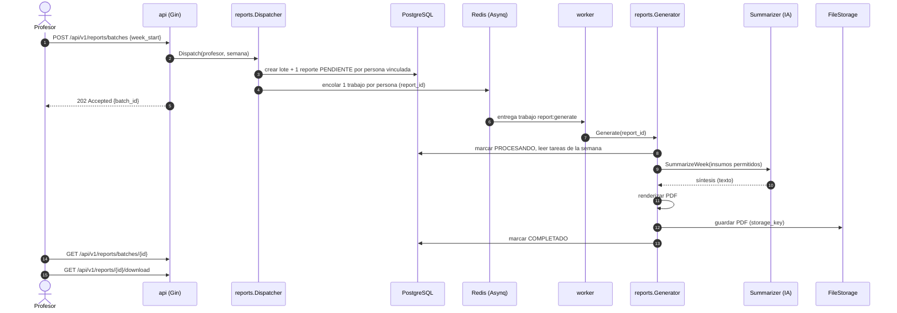

# Entrega 1 · Arquitectura de la solución

> **Grupo XX** · _Nombre completo 1 · Nombre completo 2 · Nombre completo 3 · Nombre completo 4_
>
> Estado: **propuesta para discusión del equipo**. Versión asociada: tag `entrega-1`.

Este documento describe la arquitectura del backend construido en la Entrega 1. Cubre los elementos que exige la sección 6 de los lineamientos: vista general, componentes, despliegue, datos, flujo asíncrono e integración con servicios de nube. También explica cómo la arquitectura responde a los requerimientos funcionales, las reglas de negocio y los requerimientos no funcionales, y recoge las decisiones de diseño, los compromisos técnicos y las hipótesis de trabajo. En cada entrega siguiente se crea una página equivalente (`Entrega-N-Arquitectura`) que documenta qué cambió y por qué, para mantener la continuidad que pide la sección 1.4.

---

## 1. Vista general

La plataforma permite que los profesores hagan seguimiento semanal del trabajo de monitores y asistentes graduados. En la Entrega 1 el alcance es el **backend REST**, con procesamiento asíncrono para generar reportes PDF con IA. El despliegue es local con Docker Compose.

### 1.1 Principio rector: un núcleo estable y adaptadores que evolucionan

El proyecto tiene cuatro entregas y en cada una cambia la infraestructura: local → VM con Cloud SQL y GCS → MIG con balanceador → Cloud Run con Pub/Sub. La arquitectura se diseña para que **esos cambios no toquen la lógica de negocio**:

- El **dominio** (reglas de horas, semanas, reportes tardíos, visibilidad) y los **casos de uso** se escriben una vez y no dependen de ninguna tecnología de infraestructura.
- Cada dependencia externa (base de datos, archivos, cola, IA, PDF) se accede a través de un **puerto** (interfaz).
- Cada entrega **agrega o reemplaza adaptadores** y se selecciona cuál usar por configuración (`STORAGE_DRIVER`, `QUEUE_DRIVER`, `LLM_PROVIDER`).

### 1.2 Diagrama de contexto



**Figura 1.** Contexto del sistema en la Entrega 1.

Los tres tipos de usuario interactúan con el sistema solo a través de la API REST, publicada detrás de Nginx. Las operaciones transaccionales (usuarios, espacios, vinculaciones, tareas, consultas) se resuelven de forma síncrona en la API contra PostgreSQL. La generación de reportes es la única operación costosa, porque depende de un servicio externo de IA y produce archivos. Por eso se saca del ciclo petición-respuesta: la API encola un trabajo en Redis y un proceso independiente (`worker`) lo ejecuta. Así una llamada lenta o fallida a la IA no bloquea la API. Los archivos (adjuntos y PDF) se guardan en un volumen compartido, una simplificación propia de E1 que se resolverá con Cloud Storage en E2.

### 1.3 Stack tecnológico

El enunciado (`05-stack-tecnologico.md`) fija tecnologías obligatorias y recomienda otras. La Tabla 1 indica qué se usa en cada parte de la solución y de dónde proviene cada decisión.

**Tabla 1.** Stack tecnológico de la Entrega 1.

| Aspecto | Tecnología | Versión prevista | Origen de la decisión |
|---|---|---|---|
| Lenguaje del backend | Go | 1.26 | Obligatorio |
| Framework HTTP | Gin | estable vigente | Recomendado (Gin o Echo), ver ADR-02 |
| Base de datos | PostgreSQL | 17 | Obligatorio |
| Acceso a datos y migraciones | pgx v5 + golang-migrate | estable vigente | Decisión del equipo, ver ADR-03 |
| Procesamiento asíncrono | Asynq + Redis | Redis 7 | Recomendado, ver ADR-06 |
| Proxy inverso | Nginx | 1.27 | Recomendado |
| Contenerización | Docker + Docker Compose | — | Obligatorio |
| Sistema operativo | Linux (imágenes Alpine) | Alpine 3.22 | Obligatorio |
| Integración continua | GitHub Actions | — | Obligatorio (`06-pruebas.md`) |
| Calidad de código | SonarQube | — | Obligatorio (`06-pruebas.md`) |
| Dobles de prueba | mockery (v3) + testify | estable vigente | Decisión del equipo, ver ADR-11 |
| Autenticación | bcrypt + JWT | — | Decisión del equipo, ver ADR-08 |
| Generación de PDF | go-pdf/fpdf | estable vigente | Decisión del equipo |
| IA generativa | API de Claude (SDK oficial para Go), modelo configurable | — | Decisión del equipo, ver ADR-09 |

### 1.4 Glosario del dominio

La especificación está en español y el código usa nombres en inglés, como es habitual en Go. La Tabla 2 fija la correspondencia, para que la especificación, este documento y el código hablen el mismo lenguaje.

**Tabla 2.** Términos del dominio y su nombre en el código y en la base de datos.

| Término de la especificación | Código / tabla | Definición |
|---|---|---|
| Usuario | `User` / `users` | Persona con credenciales locales y uno o más roles globales |
| Rol global | `Role` / `user_roles` | ADMIN, PROFESOR, MONITOR o ASISTENTE_GRADUADO; un usuario puede tener varios |
| Período académico | `AcademicPeriod` / `academic_periods` | Intervalo (p. ej. 2026-10) con una ventana para crear espacios |
| Espacio (curso o proyecto) | `Workspace` / `workspaces` | Curso o proyecto creado por un profesor dentro de un período |
| Vinculación | `Assignment` / `assignments` | Persona + espacio + rol (monitor o AG) + horas semanales contratadas |
| Tarea | `Task` / `tasks` | Registro de una actividad en una semana, asociado a una única vinculación |
| Semana operativa | `Week` / `week_start` | De lunes a domingo; se identifica por la fecha del lunes |
| Semana activa | — | La semana en curso según la hora actual; admite crear, editar y eliminar |
| Reporte tardío | `is_late` | Tarea creada para una semana ya cerrada; no se puede modificar |
| Sin reporte | derivado | Semana en la que una persona no registra ninguna tarea (RN-35); se calcula, no se almacena (RN-36) |
| Adjunto | `TaskAttachment` / `task_attachments` | Archivo de evidencia asociado a una tarea; el contenido vive en `FileStorage` |
| Rectificación | `AssignmentAudit` / `assignment_audit` | Registro del antes y el después de una corrección del administrador sobre una vinculación |
| Lote de reportes | `ReportBatch` / `report_batches` | Solicitud de un profesor para generar los reportes de una semana |
| Reporte semanal | `WeeklyReport` / `weekly_reports` | PDF individual generado con IA para una persona y una semana, con los datos de los espacios del profesor que lo solicita |
| Sesión | `Session` / `sessions` | Inicio de sesión en un dispositivo; su ID viaja en el token. Cerrar sesión la revoca sin afectar las demás sesiones del usuario |

---

## 2. Estilo arquitectónico

Se propone un **monolito modular con arquitectura hexagonal (puertos y adaptadores)**. Se despliega como **dos procesos** construidos a partir del mismo código y la misma imagen: `api` y `worker`.

### 2.1 Capas y regla de dependencia



**Figura 2.** Capas de la arquitectura hexagonal y sentido de las dependencias.

Las dependencias apuntan **hacia adentro**. El dominio no importa nada externo, la aplicación solo conoce dominio y puertos, y los adaptadores implementan los puertos. El único lugar que conecta todo es el *composition root* (`internal/bootstrap`): lee la configuración, crea los adaptadores concretos y los inyecta en los casos de uso. Esto permite probar el dominio y los casos de uso sin base de datos ni red, y cambiar de infraestructura entre entregas tocando solo adaptadores y configuración.

**Tabla 3.** Responsabilidad y dependencias permitidas por capa.

| Capa | Paquete | Responsabilidad | Puede depender de |
|---|---|---|---|
| Dominio | `internal/domain` | Entidades, value objects y reglas de negocio puras | Solo la biblioteca estándar |
| Puertos | `internal/ports` | Interfaces que la aplicación necesita del exterior | Dominio |
| Aplicación | `internal/app/*` | Casos de uso, transacciones, políticas de visibilidad | Dominio, puertos |
| Adaptadores de entrada | `internal/adapters/inbound/*` | REST (Gin) y consumidor de cola | Aplicación |
| Adaptadores de salida | `internal/adapters/outbound/*` | PostgreSQL, archivos, cola, IA, PDF, seguridad, reloj | Puertos, librerías externas |
| Composition root | `internal/bootstrap`, `cmd/*` | Configuración y conexión de dependencias | Todo |
| Mocks (solo pruebas) | `internal/mocks` | Dobles de prueba generados por mockery a partir de los puertos | Puertos, testify |

### 2.2 Estructura del repositorio

Hay un único repositorio para todo el proyecto (lineamientos, sección 1.2). El frontend (E2) se agregará como carpeta hermana de `backend/`.

```text
seguimiento-monitores/
├── .github/
│   ├── workflows/ci.yml            # pruebas + SonarQube + build de imágenes
│   ├── workflows/wiki.yml          # publica docs/wiki en la Wiki
│   └── pull_request_template.md
├── deploy/nginx/nginx.conf         # proxy inverso (E1-E2)
├── docs/api/openapi.yaml           # contrato OpenAPI de los endpoints implementados
├── docs/wiki/                      # fuente versionada de la Wiki
├── loadtest/                       # scripts de pruebas de carga (desde E2)
├── postman/                        # colección y plantilla de entorno para probar la API
├── docker-compose.yml
├── .env.example                    # todas las variables; .env no se versiona
├── sonar-project.properties
├── Makefile
└── backend/
    ├── Dockerfile                  # una imagen, targets: api | worker
    ├── go.mod
    ├── .mockery.yml                # configuración de mockery
    ├── cmd/
    │   ├── api/                    # proceso HTTP
    │   └── worker/                 # proceso consumidor de la cola
    ├── migrations/                 # SQL versionado (golang-migrate)
    └── internal/
        ├── config/                 # variables de entorno y drivers
        ├── bootstrap/              # composition root
        ├── domain/                 # núcleo: reglas de negocio
        ├── ports/                  # interfaces (costuras de evolución)
        ├── mocks/                  # generados por mockery desde ports/ (solo pruebas)
        ├── app/                    # casos de uso, un paquete por módulo
        │   ├── access/  auth/  users/  periods/  workspaces/
        │   └── assignments/  tasks/  supervision/  reports/
        └── adapters/
            ├── inbound/
            │   ├── rest/           # Gin: router, middleware, handlers, dto
            │   └── jobs/           # manejadores Asynq
            └── outbound/
                ├── postgres/       # repositorios, consultas, transacciones
                ├── storage/local/  # E1  (E2: storage/gcs)
                ├── queue/asynq/    # E1-E3 (E4: queue/pubsub)
                ├── llm/claude/  llm/fake/
                └── pdf/  security/  clock/
```

Cada paquete lleva sus pruebas al lado, en archivos `*_test.go`.

---

## 3. Modelo de componentes



**Figura 3.** Componentes de aplicación y los puertos que consume cada uno (hexágonos).

La Figura 3 muestra qué consume cada caso de uso. Los adaptadores de entrada solo invocan casos de uso: los handlers REST cubren todos los módulos y el consumidor de la cola solo invoca `reports.Generator`. Todos los módulos que exponen datos de terceros pasan por `access` antes de responder (línea punteada). Los dos lados del flujo de reportes están separados: `Dispatcher` solo escribe en la base de datos y publica trabajos, y `Generator` concentra las dependencias costosas (IA, PDF, almacenamiento). Por eso en E4 basta con cambiar el publicador y el consumidor.

La Tabla 4 relaciona cada módulo con los requerimientos y reglas que implementa, como trazabilidad entre la especificación y el código.

**Tabla 4.** Módulos de aplicación y su trazabilidad con requerimientos y reglas de negocio.

| Módulo (`internal/app/…`) | Responsabilidad | Requerimientos / reglas |
|---|---|---|
| `auth` | Inicio de sesión local, validación de tokens y sesiones por dispositivo (cierre de sesión, revocación por el administrador) | RF-01, RNF-03, DT-03 |
| `access` | Políticas de visibilidad por relación usuario ↔ dato | RF-12, RN-03 a RN-05 |
| `users` | Creación de usuarios, asignación de roles, consulta global | RF-02, RF-15.2, RN-01 |
| `periods` | Períodos académicos y ventana de creación | RF-03.2, RN-07 |
| `workspaces` | Cursos y proyectos: crear, consultar, cerrar | RF-03, RN-06, RN-08, RN-09 |
| `assignments` | Vinculaciones y validación de carga horaria; rectificación del administrador | RF-04, RF-05, RF-15.3, RN-10 a RN-19 |
| `tasks` | Registro semanal, estados, tardíos, adjuntos | RF-06 a RF-08, RN-20 a RN-34 |
| `supervision` | Vistas del profesor y del usuario operativo (solo lectura) | RF-10, RF-11 |
| `reports` | Despacho por lotes y generación de PDF con IA | RF-14, RN-41 a RN-46 |

La Tabla 5 detalla cada puerto, quién lo usa y qué adaptador lo implementa en E1.

**Tabla 5.** Puertos de salida, módulos consumidores y adaptador de la Entrega 1.

| Puerto (`internal/ports`) | Usado por | Adaptador E1 |
|---|---|---|
| Repositorios + `TxManager` | todos los módulos | `postgres` (pgx) |
| `SessionRepository` | `auth` (en cada petición autenticada) | `postgres` (tabla `sessions`) |
| Consultas de lectura | `supervision`, `reports` | `postgres` |
| `FileStorage` | `tasks` (adjuntos), `reports` (PDF) | `storage/local` |
| Publicador de trabajos | `reports` (despacho) | `queue/asynq` |
| `Summarizer` (IA) | `reports` (generación) | `llm/claude` · `llm/fake` |
| `PDFRenderer` | `reports` | `pdf` (go-pdf/fpdf) |
| `PasswordHasher`, `TokenService` | `auth`, `users` | `security` (bcrypt, JWT) |
| `Clock` | `auth` (vencimiento de sesiones); luego `tasks`, `workspaces`, `reports` | `clock` |

---

## 4. Modelo de despliegue



**Figura 4.** Despliegue local de la Entrega 1 con Docker Compose.

Todo el sistema se levanta con `docker compose up` sobre un host Linux. Solo Nginx publica un puerto hacia el exterior (8080); los demás servicios se comunican por la red interna de Compose. `api` y `worker` salen de la misma imagen (`backend/Dockerfile`) con *targets* distintos, lo que garantiza que ejecutan exactamente el mismo código de dominio. Compose solo arranca la API cuando pasan los *healthchecks* de la base de datos y Redis.

**Tabla 6.** Servicios del despliegue local.

| Servicio | Imagen / target | Rol | Persistencia |
|---|---|---|---|
| `nginx` | `nginx:1.27-alpine` | Única entrada pública, proxy a `/api/` | — |
| `api` | `backend/Dockerfile` → `api` | REST, sin estado | volumen `files` (solo E1) |
| `worker` | `backend/Dockerfile` → `worker` | Consume trabajos de reportes | volumen `files` (solo E1) |
| `db` | `postgres:17-alpine` | Base de datos relacional | volumen `pgdata` |
| `redis` | `redis:7-alpine` | Broker de Asynq | — |

En E1 `api` y `worker` comparten el volumen `files`: el worker escribe los PDF y la API los sirve. Es una simplificación deliberada que se resuelve en E2 con Cloud Storage; se registrará como deuda técnica cuando se implementen los adjuntos y los reportes.

---

## 5. Modelo de datos



**Figura 5.** Modelo entidad-relación de la Entrega 1. Los comentarios de columna resumen las restricciones clave; `UK` en varias columnas de una misma tabla indica una restricción única compuesta. El detalle completo está en las decisiones del modelo.

El modelo se centra en las **personas y sus vinculaciones** (RN-47), no en los proyectos. La vinculación (`ASSIGNMENTS`) es la entidad pivote: une a una persona con un curso o proyecto bajo un rol y unas horas contratadas, y es el punto del que cuelgan las tareas. Así, toda tarea pertenece a exactamente un espacio (RN-21), y las validaciones de carga horaria se calculan sumando las vinculaciones activas de una persona.

### 5.1 Vista de dominio

El paquete `internal/domain` expresa el mismo problema que el modelo de datos, pero en términos de comportamiento: qué agrupa cada concepto, qué invariantes protege y cuándo cambia de estado. No conoce tablas ni SQL; los repositorios traducen entre ambos mundos. Está implementado y probado en `internal/domain`; los casos de uso y los repositorios que lo usan se construyen módulo a módulo. El dominio no lee la hora del sistema: recibe el instante como parámetro (el `Clock` se inyecta en la capa de aplicación).



**Figura 5b.** Vista de dominio: agregados, entidades, value objects y servicio de dominio. La flecha con rombo (`*--`) indica pertenencia dentro del mismo agregado; la flecha simple, referencia por identificador a otro agregado. Los atributos marcados `FK` son esos identificadores y coinciden con las claves foráneas del modelo de datos (Figura 5).

**Tabla 5b.** Agregados del dominio y su correspondencia con el modelo de datos.

| Agregado (raíz) | Contiene | Tablas | Archivo en `domain/` |
|---|---|---|---|
| `User` | `Role` (value object) | `users`, `user_roles` | `user.go` |
| `AcademicPeriod` | — | `academic_periods` | `period.go` |
| `Workspace` | — | `workspaces` | `workspace.go` |
| `Assignment` | `AssignmentAudit` | `assignments`, `assignment_audit` | `assignment.go` |
| `Task` | `TaskAttachment`, `TaskStatus`, `Week` | `tasks`, `task_attachments` | `task.go`, `attachment.go`, `week.go` |
| `ReportBatch` | `WeeklyReport` | `report_batches`, `weekly_reports` | `report.go` |
| (servicio) `WorkloadRule` | — | — (opera sobre `assignments` activas) | `workload.go` |

Los agregados se referencian entre sí **solo por identificador** (una tarea guarda el `id` de su vinculación, no la carga completa). Así, registrar una tarea no obliga a cargar todas las tareas de la vinculación ni todas las vinculaciones de la persona. `Task` es raíz de su propio agregado y no cuelga de `Assignment` por esa misma razón: una vinculación acumula tareas semana tras semana.

**Tabla 5c.** Invariantes que protege cada concepto del dominio y su segunda línea de defensa en la base de datos.

| Concepto | Invariante | Regla | Respaldo en BD |
|---|---|---|---|
| `User` | Un correo identifica a un único usuario; puede tener varios roles globales | RN-01, RF-01.3 | `UNIQUE lower(email)`, PK `(user_id, role)` |
| `AcademicPeriod` | Solo acepta crear espacios si está `ACTIVO` y `hoy <= creationDeadline` | RN-07 | `CHECK` de fechas y estado |
| `Workspace` | Es curso o proyecto; está activo o cerrado; cerrado es solo lectura y no admite tareas ni vinculaciones nuevas | RN-06, RN-08, RN-09 | `CHECK` de tipo y estado; `closed_at` coherente con `status` |
| `Assignment` | Tiene rol de vinculación, espacio, persona y horas semanales `> 0` | RN-11 | `CHECK weekly_hours > 0` y tope por rol |
| `Assignment` | Las horas contratadas son inmutables; solo el administrador las rectifica, dejando registro | RN-12, RF-04.5 | `assignment_audit` |
| `Assignment` | Solo cuenta para los límites de horas mientras su espacio está activo | Hipótesis 1, RN-13 | — (se calcula) |
| `Assignment` | Una persona tiene una vinculación por espacio | Hipótesis 3 | `UNIQUE (user_id, workspace_id)` |
| `WorkloadRule` | 22 h de AG; 3 monitorías; 12 h de monitoría; monitoría `<= ⌈40 %⌉` de las horas de AG | RN-14 a RN-19 | Tope por rol (solo cota la vinculación individual) |
| `Task` | Pertenece a una sola vinculación y su semana nunca cambia: continuar en otra semana exige una tarea nueva | RN-21, RN-26 | FK `assignment_id` |
| `Task` | Estado dentro de un catálogo cerrado; horas enteras `>= 0` | RN-24, RN-27, RN-28 | `CHECK` de estado y de horas |
| `Task` | `isLate` se fija al crear (semana ya cerrada) y no se recalcula | RN-32 | — |
| `Task` | Solo se modifica o elimina si su semana está activa, no es tardía y su espacio está activo | RN-30, RN-33, RN-34, RN-09 | — |
| `Task` | No se crean tareas en semanas futuras | Hipótesis 4 | — |
| `Week` | Va de lunes a domingo y se identifica por su lunes | RN-29 | `CHECK ISODOW = 1` |
| `TaskAttachment` | Pertenece a una tarea; el contenido vive fuera de la base de datos | RN-23 | FK con `ON DELETE CASCADE` |
| `ReportBatch` | Lo solicita un profesor para una semana; su `status` se almacena y se recalcula a partir del estado de sus reportes (`RefreshStatus`) | RN-41, RN-44 | `CHECK` de estado y de lunes |
| `WeeklyReport` | Su semana coincide con la de su lote (se copia al crear) | RN-44 | `CHECK` de lunes; la igualdad con el lote no la impone la BD |
| `WeeklyReport` | Uno por persona en cada lote; solo pasa `PENDIENTE → PROCESANDO → COMPLETADO` o `FALLIDO`; `COMPLETADO` implica un PDF almacenado | RN-42, RN-45 | `UNIQUE (batch_id, user_id)`; `CHECK` de `storage_key` |

**Estado derivado.** *Sin reporte* no es una entidad ni una columna: es el resultado de cruzar vinculaciones, semanas y tareas (RN-36). Queda fuera del alcance de E1, pero el dominio ya lo permite sin cambios.

**Lo que no es dominio.** La visibilidad por relación (RN-03 a RN-05) es una política de la capa de aplicación (`app/access`), porque depende de quién consulta y no de la naturaleza del dato. La orquestación del lote de reportes (encolar, generar, almacenar) pertenece a `app/reports`; al dominio solo le corresponden los estados y sus transiciones.

**Decisiones del modelo:**

- **Profesor responsable de una vinculación** (RN-11): se obtiene del `professor_id` del curso o proyecto. No se duplica en `assignments`, para evitar inconsistencias.
- **Semana**: se representa con `week_start DATE`, la fecha del lunes. Un `CHECK (EXTRACT(ISODOW FROM week_start) = 1)` garantiza que siempre sea lunes en `tasks`, `report_batches` y `weekly_reports`.
- **Restricciones en BD como segunda línea de defensa**: la regla de negocio vive en el dominio; la BD evita datos corruptos si hay un error de programación.
  - Catálogos: `CHECK` sobre `type`, `status` y `role` de todas las tablas, incluidos `report_batches.status` y `weekly_reports.status`.
  - Horas: `weekly_hours > 0`, `hours_spent >= 0` y un tope por rol (`role = 'ASISTENTE_GRADUADO'` ⇒ `weekly_hours <= 22`; `role = 'MONITOR'` ⇒ `weekly_hours <= 12`). La suma de varias vinculaciones la valida el dominio, no la BD.
  - Fechas: `start_date <= end_date` en espacios; `start_date <= creation_deadline <= end_date` en períodos.
  - Cierre: `status = 'CERRADO'` ⇔ `closed_at IS NOT NULL` en espacios.
  - Reportes: `status <> 'COMPLETADO' OR storage_key IS NOT NULL` en `weekly_reports`.
  - Unicidad: `UNIQUE (user_id, workspace_id)` en `assignments` (hipótesis 3) y `UNIQUE (batch_id, user_id)` en `weekly_reports`.
- **Estado *sin reporte*** (RF-09, fuera del alcance de E1): **no se almacena**. Se calcula cruzando vinculaciones y semanas contra `tasks`, como exige RN-36. El modelo ya lo soporta sin cambios.
- **Archivos**: la BD solo guarda `storage_key`. El contenido está detrás de `FileStorage`, así que el esquema no cambia al migrar a GCS.
- **Trazabilidad de rectificaciones**: `assignment_audit` registra el antes y el después de cada corrección del administrador (RF-04.5).
- **Integridad referencial (`ON DELETE`)**: `task_attachments → tasks` en `CASCADE` (al eliminar una tarea se eliminan sus adjuntos y el caso de uso borra los archivos mediante `FileStorage`); `user_roles → users` y `sessions → users` en `CASCADE`; todas las demás relaciones en `RESTRICT`, porque no existe borrado de usuarios, espacios ni vinculaciones.
- **Reportes por profesor**: `weekly_reports` no se vincula a una vinculación, pero su lote conserva `professor_id`. El generador usa ese dato para limitar los insumos a las tareas de los espacios de ese profesor (RN-03, ver Tabla 7).
- **Sesiones** (`000002_create_sessions`): una fila por inicio de sesión, y el token lleva su ID. Cerrar sesión borra la fila. Las sesiones vencidas se borran al abrir una sesión nueva del mismo usuario y, para todo el sistema, al arrancar la API. Si se elimina un usuario, sus sesiones se borran en cascada.
- **Índices**: `user_roles(role)` y `sessions(user_id)`, `sessions(expires_at)` para usuarios y sesiones; `workspaces(professor_id)`, `workspaces(period_id)`, `assignments(workspace_id)`, `assignment_audit(assignment_id)`, `tasks(assignment_id, week_start)`, `task_attachments(task_id)`, `report_batches(professor_id, week_start)` y `weekly_reports(user_id)` para el resto del modelo. Las consultas por `assignments(user_id)` y por `weekly_reports(batch_id)` las cubren los índices de sus restricciones `UNIQUE`.
- **Migraciones**: el esquema crece por archivos numerados, embebidos en el binario y aplicados al arrancar con un *advisory lock*, así que varias instancias pueden arrancar a la vez (E3). `000001_create_users` y `000002_create_sessions` nacieron con RF-01 y RF-02. Las migraciones `000003` a `000006` (períodos y espacios, vinculaciones y auditoría, tareas y adjuntos, lotes y reportes) se adelantaron junto con el dominio para fijar el modelo completo antes de construir los casos de uso: esas tablas existen, pero ningún módulo las usa todavía.
- **Correo único sin distinguir mayúsculas**: el dominio guarda el correo en minúsculas y la BD lo exige con `CHECK (email = lower(email))` y `UNIQUE (email)`.

---

## 6. Reglas de negocio críticas: dónde y cómo se garantizan

La sección 13 de las reglas de negocio pide validaciones transaccionales, control temporal explícito y control de acceso estricto. La Tabla 7 indica, para las reglas de mayor riesgo, en qué componente vive cada una y qué mecanismo la hace cumplir.

**Tabla 7.** Ubicación y mecanismo de cumplimiento de las reglas de negocio críticas.

| Regla | Dónde vive | Cómo se garantiza |
|---|---|---|
| Carga horaria: 22 h AG; 3 monitorías / 12 h; 40 % con redondeo hacia arriba (RN-14 a RN-19) | `domain/workload.go` | Función pura sobre las vinculaciones activas + la candidata. Se invoca en `app/assignments` **dentro de una transacción con bloqueo de la persona** (`SELECT … FOR UPDATE` sobre `users`), para que dos profesores no puedan exceder el límite en paralelo |
| Inmutabilidad de horas contratadas (RN-12) | `domain/assignment.go` | Sin operación de edición para profesor ni operativo. Solo `PATCH /admin/assignments/{id}`, que **re-valida la carga** excluyendo la vinculación editada, con el mismo bloqueo de la persona que la creación, y deja registro en `assignment_audit` |
| Semana lun-dom, edición solo en semana activa, reporte tardío inmutable (RN-29 a RN-34) | `domain/week.go`, `domain/task.go` | `Clock` inyectado y zona horaria `APP_TIMEZONE`. `is_late` se calcula **al crear** y nunca se recalcula (ver Tabla 8) |
| Espacio cerrado = solo lectura (RN-09) | `domain/workspace.go` | Los casos de uso de tareas y vinculaciones verifican el estado del espacio antes de escribir |
| Creación de espacios solo en la ventana del período (RN-07) | `domain/period.go` | Período `ACTIVO` y `hoy <= creation_deadline` |
| Visibilidad por rol y relación (RN-03 a RN-05) | `app/access` | Dos niveles: el middleware RBAC filtra por rol y la política de `access` filtra por relación (profesor ↔ espacio ↔ persona, dueño de la tarea) |
| Insumos permitidos del reporte IA (RN-43, RN-46) | `app/reports/generator.go` | El contexto del prompt se arma solo con tareas, descripciones, observaciones y horas. El prompt pide una síntesis, no una evaluación |
| Aislamiento de los reportes entre profesores (RN-03, RF-12.1) | `app/reports/generator.go`, consulta de lectura | La consulta de insumos filtra por `batch.professor_id`: solo entran tareas de vinculaciones en espacios de ese profesor, aunque la persona tenga vinculaciones con otros. Se prueba con una persona vinculada a dos profesores |

### 6.1 Validación transaccional al crear una vinculación

La validación de carga horaria es la regla con mayor riesgo de inconsistencia, porque depende de las vinculaciones que la persona tenga en espacios de **otros** profesores. La Figura 6 muestra cómo se garantiza.



**Figura 6.** Secuencia de creación de una vinculación con validación bloqueante de carga horaria.

El bloqueo sobre la fila de la persona serializa las vinculaciones que se crean al mismo tiempo **para la misma persona**. Sin él, dos profesores podrían leer el mismo estado inicial y, entre los dos, superar el límite. Las vinculaciones de personas distintas no se bloquean entre sí. El rechazo responde con `422` e indica cuál regla se incumplió, como exige RF-05.6: la validación bloquea la operación, no es solo una advertencia.

### 6.2 Operaciones permitidas sobre una tarea

Las reglas temporales (RN-30 a RN-34) y la de espacios cerrados (RN-09) se combinan. La Tabla 8 resume el resultado.

**Tabla 8.** Operaciones permitidas sobre una tarea según su semana y el estado del espacio.

| Semana de la tarea | Crear tarea nueva | Editar / cambiar estado | Eliminar |
|---|---|---|---|
| Activa (en curso) | Sí | Sí | Sí |
| Cerrada | Sí, marcada como **tardía** (RN-31, RN-32) | No: ni las creadas a tiempo (RN-34) ni las tardías (RN-33) | No (RN-34) |
| Futura | No (hipótesis 4) | — | — |
| Cualquiera, con el espacio cerrado | No (RN-09) | No | No |


---

## 7. Flujo de procesamiento asíncrono: generación de reportes con IA



**Figura 7.** Secuencia de la generación por lotes de reportes semanales.

El flujo tiene dos mitades desacopladas por la cola. En la primera (pasos 1 a 5), la API valida la solicitud, registra el lote y los reportes en estado `PENDIENTE`, encola un trabajo por persona y responde de inmediato con `202 Accepted`; el profesor no espera la generación. En la segunda (pasos 6 a 13), el worker procesa cada trabajo por su cuenta: consulta los datos de la semana, pide la síntesis a la IA, genera el PDF, lo almacena y actualiza el estado. El profesor consulta el avance del lote y descarga los PDF cuando están listos (pasos 14 y 15).

**Decisiones del flujo:**

- **Un trabajo por persona** en lugar de uno por lote: aísla fallos, permite reintentar individualmente y paralelizar con `WORKER_CONCURRENCY`, y coincide con el diseño exigido en E4 (*un mensaje de Pub/Sub por persona*).
- **Idempotencia**: el ID de la tarea en Asynq es el `report_id`, y el generador no repite el trabajo si el reporte ya está `COMPLETADO`. Esto tolera reintentos y la entrega *at-least-once* de Pub/Sub en E4.
- **Reintentos acotados** (p. ej. 3 con *backoff*). Después del último el reporte queda `FALLIDO` con el error registrado.
- **Estado del lote**: `report_batches.status` pasa a `COMPLETADO` cuando todos sus reportes son `COMPLETADO`, y a `COMPLETADO_CON_ERRORES` cuando ninguno está pendiente y alguno es `FALLIDO`. Mientras haya reportes `PENDIENTE` o `PROCESANDO` queda en `EN_PROCESO`.
- **Aislamiento entre profesores**: el generador solo lee las tareas de los espacios del profesor que creó el lote (Tabla 7).
- **IA intercambiable**: `LLM_PROVIDER=fake` en desarrollo y CI (determinista, sin costo); `claude` para la demostración, con el modelo configurable por `LLM_MODEL`.

---

## 8. Integración con servicios del proveedor de nube

**En la Entrega 1 no se usan servicios de nube**: el enunciado exige un despliegue local reproducible con contenedores. El único servicio externo es la API de IA generativa, a la que se accede con una credencial inyectada por variable de entorno.

Sin embargo, la arquitectura se diseñó para que la integración con GCP en las entregas siguientes sea incremental. La Tabla 9 muestra qué componente cambia en cada entrega y qué permanece igual.

**Tabla 9.** Evolución prevista de los componentes por entrega.

| Componente | E1 · Local | E2 · VM + Cloud SQL + GCS | E3 · MIG + balanceador | E4 · Cloud Run + Pub/Sub |
|---|---|---|---|---|
| Dominio + casos de uso | se construyen | sin cambios | sin cambios | sin cambios |
| API (`cmd/api`) | contenedor tras Nginx | contenedor en Compute Engine | plantilla de instancia en el MIG | servicio Cloud Run |
| Entrada HTTP | Nginx | Nginx | Cloud Load Balancing | gestionada por Cloud Run |
| Base de datos | Postgres en contenedor | Cloud SQL | Cloud SQL (cuenta de servicio) | Cloud SQL vía conector (socket) |
| Archivos | `storage/local` | **+ `storage/gcs`** | `storage/gcs` (obligatorio, sin disco local) | `storage/gcs` |
| Asíncrono | `queue/asynq` + Redis + `cmd/worker` | igual (Redis en la VM) | igual (Redis compartido por el grupo) | **+ `queue/pubsub`** + endpoint push; se retiran Asynq, Redis y `cmd/worker` |
| Frontend | — | **+ `web/`** | igual | igual |

**Qué se agrega en el código en cada entrega:**

- **E2**: adaptador `internal/adapters/outbound/storage/gcs`, carpeta `web/` con el frontend, middleware CORS si el frontend se sirve desde otro origen y un job de CI para el frontend.
- **E3**: no se esperan cambios de código si E1 y E2 respetaron que la API sea *stateless*. `/healthz` se usa como health check del balanceador y las credenciales salen de la cuenta de servicio vía ADC.
- **E4**: adaptador de salida `queue/pubsub` (publicador) y adaptador de entrada `inbound/pubsub` (endpoint push protegido) que invoca **el mismo** `reports.Generator`. Se eliminan `queue/asynq`, `inbound/jobs` y `cmd/worker`.

Para que esta evolución sea posible, desde E1 se exige: proceso API sin estado, apagado ordenado con `SIGTERM`, puerto tomado de `PORT`, un endpoint de salud y ninguna ruta de archivo fuera de `FileStorage`.

---

## 9. Seguridad

- **Autenticación local** (RF-01.1): el identificador es el correo, normalizado a minúsculas. Las contraseñas se guardan con **bcrypt**, con un costo configurable (`BCRYPT_COST`). Ante un correo inexistente o una contraseña incorrecta, la respuesta es la misma (`invalid_credentials`), para no revelar qué correos están registrados.
- **Política de contraseñas**: mínimo 8 caracteres y máximo 72 bytes, que es el límite real de bcrypt; más allá de él, los bytes se ignorarían en silencio.
- **Token de acceso = identidad + sesión**: JWT firmado con HS256. Lleva `sub` (ID del usuario), `sid` (ID de la sesión), `iss`, `iat` y `exp` (`JWT_TTL`, 8 h por defecto), y **no lleva roles**. Al validarlo se exige el algoritmo HS256 (se rechazan `none` y otros algoritmos), el emisor y la expiración.
- **Sesión activa y roles vigentes en cada petición** (RF-01.2, RNF-06): el middleware valida el token y, en una sola consulta por clave primaria (`SessionRepository.ActiveRoles`), verifica que la sesión siga activa y lee los roles actuales del usuario. Por eso un cambio de roles o un cierre de sesión aplican en la siguiente petición con el mismo token, y `/me` y la autorización nunca se contradicen. Una sesión cerrada o vencida responde `401 session_revoked`. El costo es una consulta por petición autenticada (alrededor de 1 ms en local); se medirá en las pruebas de carga de E2.
- **Sesiones por dispositivo** (DT-03): cada inicio de sesión abre una sesión con el agente de usuario y la IP del cliente. `POST /auth/logout` cierra **solo** la sesión desde la que se llama; las del mismo usuario en otros dispositivos siguen activas. El administrador puede listar las sesiones activas de un usuario y cerrarlas todas, por ejemplo si un token fue robado. Como las sesiones viven en la BD compartida, cualquier instancia ve el mismo estado (requisito de E3). El agente de usuario se normaliza a UTF-8 válido antes de guardarse, porque HTTP admite cabeceras en Latin-1 y PostgreSQL rechazaría el texto.
- **Varios roles por usuario** (RF-01.3): el control por rol admite el acceso si el usuario tiene **alguno** de los roles que exige la ruta.
- **Protección del último administrador**: no se puede quitar el rol ADMIN al único administrador (`409 last_admin`). Así el sistema nunca queda sin nadie que gestione usuarios.
- **Sin estado en el servidor**: no hay sesiones en memoria. Esto prepara E3 (varias instancias detrás del balanceador) y E4 (Cloud Run).
- **Autorización en dos niveles**: middleware RBAC por grupo de rutas y políticas de relación en `app/access`. Los handlers nunca deciden visibilidad.
- **Secretos**: solo por variables de entorno. `.env` no se versiona y `.env.example` documenta las claves con valores de ejemplo (lineamientos, sección 10).
- **Adjuntos**: límite de tamaño (Nginx + `MAX_UPLOAD_MB`), lista de tipos permitidos y nombre de almacenamiento generado por el sistema, nunca el nombre del usuario.

---

## 10. API REST

Prefijo `/api/v1`. AG = asistente graduado. Formato JSON; los errores siguen un esquema único `{ "error": { "code", "message", "details" } }`. El administrador reutiliza los endpoints de consulta con visibilidad total (RF-12.3, RF-15.1).

Los errores de dominio se traducen a HTTP en un único lugar (`middleware/errors.go`) según su tipo:

- `400 invalid_request`: JSON o parámetros mal formados.
- `401`: sin token, token inválido, sesión cerrada o vencida (`session_revoked`) o credenciales incorrectas.
- `403 forbidden`: rol insuficiente.
- `404`: recurso inexistente.
- `409`: conflicto con el estado actual (correo duplicado, último administrador).
- `422 validation_failed`: datos inválidos, con el detalle de **todos** los campos en `details`.
- `500 internal_error`: se registra en el log con su `request_id` y no expone detalles internos.

El contrato detallado de los endpoints **ya implementados** está en `docs/api/openapi.yaml` (OpenAPI 3.0): esquemas de petición y respuesta, códigos de estado y ejemplos de error. Se valida con Redocly, y se comprobó contra la API en ejecución que cada respuesta real cumpla el esquema documentado para su código de estado. La Tabla 10 conserva la vista completa prevista para la entrega.

**Tabla 10.** Contrato propuesto de la API REST.

| Método | Ruta | Rol | RF |
|---|---|---|---|
| POST | `/auth/login` | público | RF-01.1 |
| POST | `/auth/logout` | autenticado | RF-01 (cierra la sesión del dispositivo) |
| GET | `/me` | autenticado | RF-01.3 |
| POST | `/admin/users` | ADMIN | RF-02.1 |
| GET | `/admin/users` | ADMIN | RF-02.3 |
| PUT | `/admin/users/{id}/roles` | ADMIN | RF-02.2 |
| GET | `/admin/users/{id}/sessions` | ADMIN | RF-15 (sesiones activas del usuario) |
| DELETE | `/admin/users/{id}/sessions` | ADMIN | RF-15 (cierra todas sus sesiones) |
| POST | `/admin/periods` | ADMIN | RF-03.2 |
| PATCH | `/admin/periods/{id}` | ADMIN | RF-03.2 |
| GET | `/periods` | autenticado | RF-03.2 |
| PATCH | `/admin/assignments/{id}` | ADMIN | RF-04.5, RF-15.3 |
| POST | `/workspaces` | PROFESOR | RF-03.1, RF-03.3 |
| GET | `/workspaces?status=` | PROFESOR, ADMIN | RF-03.4, RF-03.6 |
| GET | `/workspaces/{id}` | PROFESOR, ADMIN | RF-03.6 |
| POST | `/workspaces/{id}/close` | PROFESOR | RF-03.5 |
| POST | `/workspaces/{id}/assignments` | PROFESOR | RF-04.1 a RF-04.3, RF-05 |
| GET | `/workspaces/{id}/assignments` | PROFESOR, ADMIN | RF-10.2 |
| GET | `/supervision/people` | PROFESOR, ADMIN | RF-10.1, RF-10.2 |
| GET | `/supervision/people/{userId}/weeks/{weekStart}` | PROFESOR, ADMIN | RF-10.3, RF-10.5, RF-10.6 |
| GET | `/supervision/people/{userId}/summary` | PROFESOR, ADMIN | RF-10.4 |
| GET | `/me/assignments` | MONITOR, AG | RF-11.1 |
| GET | `/me/tasks?week=` | MONITOR, AG | RF-11.2, RF-11.3 |
| POST | `/assignments/{id}/tasks` | MONITOR, AG (dueño) | RF-06.1 a RF-06.6, RF-08.3, RF-08.4 |
| PUT | `/tasks/{id}` | dueño | RF-06.7, RF-07.2 |
| DELETE | `/tasks/{id}` | dueño | RF-06.8 |
| POST | `/tasks/{id}/attachments` | dueño | RF-06.4 |
| GET | `/attachments/{id}` | dueño, profesor, ADMIN | RF-06.4 |
| POST | `/reports/batches` | PROFESOR | RF-14.1, RF-14.2 |
| GET | `/reports/batches/{id}` | PROFESOR | RF-14 |
| GET | `/reports?week=` | PROFESOR, ADMIN | RF-14.6 |
| GET | `/reports/{id}/download` | PROFESOR, ADMIN | RF-14.6 |
| GET | `/healthz` (sin prefijo) | público | operación: health check (Docker; balanceador en E3) |

---

## 11. Configuración

Toda la configuración se toma de variables de entorno; `.env.example` documenta la lista completa. La Tabla 11 muestra las variables más relevantes. Las marcadas con ⇄ son las que **cambian entre entregas sin tocar código**.

**Tabla 11.** Variables de configuración relevantes y su evolución.

| Variable | E1 | Evolución |
|---|---|---|
| `DATABASE_URL` ⇄ | contenedor `db` | E2-E3: Cloud SQL · E4: socket del conector Cloud SQL |
| `STORAGE_DRIVER` ⇄ | `local` | E2+: `gcs` (+ `GCS_BUCKET`) |
| `QUEUE_DRIVER` ⇄ | `asynq` | E4: `pubsub` |
| `LLM_PROVIDER` | `fake` / `claude` | — |
| `PORT` | `8080` | Cloud Run lo inyecta en E4 |
| `JWT_SECRET`, `JWT_TTL` | secreto local (≥ 32 caracteres); duración de cada sesión y de su token: `8h` | E2+: el secreto se inyecta desde el entorno de despliegue, nunca desde el repositorio |
| `BCRYPT_COST` | `10` | Ajustable según las pruebas de carga: cada punto duplica la CPU por inicio de sesión |
| `APP_TIMEZONE` | `America/Bogota` | — |
| `BOOTSTRAP_ADMIN_NAME`, `BOOTSTRAP_ADMIN_EMAIL`, `BOOTSTRAP_ADMIN_PASSWORD` | datos del administrador inicial; se crea al arrancar si no existe ninguno (DT-05) | E2+: se inyectan desde el entorno de despliegue, con una contraseña propia |

---

## 12. Atributos de calidad y requerimientos no funcionales

La Tabla 12 muestra cómo responde la arquitectura a cada requerimiento no funcional de la especificación (`04-requerimientos-no-funcionales.md`) y en qué sección se detalla la respuesta.

**Tabla 12.** Respuesta arquitectónica a los requerimientos no funcionales.

| RNF | Requerimiento | Respuesta arquitectónica | Detalle |
|---|---|---|---|
| RNF-01 | Aplicación web sencilla, con énfasis en el backend | Monolito modular con API REST como única interfaz; dos procesos de un mismo código | §2, §10 |
| RNF-02 | Registro semanal ágil, idealmente desde una sola pantalla | La API permite armar esa pantalla con pocas llamadas: `GET /me/assignments` (espacios del usuario), `GET /me/tasks?week=` (tareas de la semana) y las operaciones de tarea por vinculación | §10 |
| RNF-03 | Autenticación local y control de acceso por roles | bcrypt + JWT; RBAC en middleware y políticas de relación en `app/access` | §6, §9 |
| RNF-04 | Persistencia de tareas, vinculaciones, notificaciones y PDF | PostgreSQL con migraciones versionadas; archivos detrás de `FileStorage` con su clave en BD; volúmenes Docker en E1. Las notificaciones están fuera del alcance de E1, pero el modelo admite agregarlas | §5, §17 |
| RNF-05 | Mantenibilidad: estructura modular, comprensible y ordenada | Capas hexagonales con regla de dependencias, un módulo por área funcional, glosario común, `gofmt` + `go vet` + SonarQube en CI | §1.4, §2, §3, §14 |
| RNF-06 | Consistencia en horas, cierre semanal, tardíos y visibilidad | Reglas en el dominio puro, validación transaccional con bloqueo, restricciones en BD como segunda defensa y pruebas unitarias de cada regla | §5, §6, §14 |

Aunque no es un RNF de la Entrega 1, la **escalabilidad** es el atributo central del curso. La API sin estado y los puertos de almacenamiento y cola (§8) son la base para escalar horizontalmente en E3 y E4.

---

## 13. Observabilidad y preparación para pruebas de carga

La Entrega 1 no exige pruebas de carga, pero desde la Entrega 2 los lineamientos (sección 7) piden registrar tiempos de respuesta, percentiles, *throughput*, errores, CPU, memoria, red y comportamiento de la base de datos, y **explicar qué componente se convierte en restricción**. Si el sistema no se instrumenta desde el principio, esa explicación no es posible. Por eso se toman desde ahora estas decisiones:

- **Logs estructurados** (JSON con `log/slog`) en la API, con `request_id`, ruta, código de respuesta y latencia por petición.
- **Duración por etapa en el worker**: consulta, llamada a la IA, render del PDF y almacenamiento, registradas por separado. Así se puede atribuir la latencia de un reporte a la etapa que la causa.
- **Métricas de aplicación** (propuesta a decidir): un endpoint `/metrics` en formato Prometheus con histogramas de latencia por ruta, estado del *pool* de conexiones y trabajos encolados, procesados y fallidos.
- **Base de datos**: `pg_stat_statements` habilitado para identificar las consultas más costosas.
- **Datos reproducibles**: un *seed* con volumen parametrizable (profesores, personas, vinculaciones, tareas) para que cada corrida parta del mismo estado. Las pruebas deben ser repetibles (sección 7). Los scripts y datos irán en `loadtest/`.
- **Costo de autenticación medible**: cada petición autenticada ejecuta una consulta de sesión y roles por clave primaria (ADR-08). Su peso aparecerá en los escenarios de escritura y lectura de E2, y debe distinguirse del costo propio de cada operación.
- **Escenarios candidatos** para el plan de E2:
  - inicio de sesión: intensivo en CPU por bcrypt (escenario 1 obligatorio, "autenticación concurrente"; `BCRYPT_COST` es configurable);
  - registro de tareas: escritura con validaciones;
  - vista consolidada del profesor: lectura con agregaciones;
  - despacho de un lote de reportes: rendimiento del worker y dependencia de la IA.

---

## 14. Estrategia de pruebas e integración continua

Las pruebas se concentran donde está el valor de la solución: las reglas de negocio y el control de acceso (enunciado, `06-pruebas.md`). La Tabla 13 resume los niveles de prueba.

**Tabla 13.** Niveles de prueba y su alcance.

| Nivel | Qué se prueba | Cómo |
|---|---|---|
| Dominio | Carga horaria, semanas, tardíos, transiciones de estado | Pruebas *table-driven* sin dependencias, con casos límite (22/9, 12/5, 3 monitorías, cambio de semana domingo → lunes) |
| Aplicación | Casos de uso y políticas de visibilidad | Mocks de los puertos generados con mockery (`internal/mocks`); `Clock` fijo |
| REST | Endpoints: códigos, validación, autorización | `httptest` + Gin con casos de uso simulados |
| Integración | Repositorios PostgreSQL (SQL real, restricciones, transacciones) | Pruebas con la etiqueta de compilación `integration`, contra un servicio `postgres:17` efímero en CI (`make test-integration` en local) |

**Mocks vs. adaptador `fake`:** los mocks de `internal/mocks` solo existen en las pruebas. Reemplazan un puerto para verificar cómo lo usa un caso de uso. El adaptador `llm/fake`, en cambio, es una implementación real del puerto de IA que se usa al **ejecutar** el sistema sin credenciales (desarrollo local y CI). Los mocks se generan con `make mocks`, se versionan junto al código y el pipeline falla si quedan desactualizados respecto a los puertos.

**Pipeline (GitHub Actions):** `gofmt` → `go vet` → verificación de mocks → `go test -race` con cobertura (`-coverpkg`, para atribuir la cobertura a los paquetes que ejercita cada prueba) → pruebas de integración contra PostgreSQL → análisis SonarQube (con el reporte de cobertura) → build de las imágenes `api` y `worker`. Requiere los secretos `SONAR_TOKEN` y `SONAR_HOST_URL`. La rama `main` se protege: solo se integran PR con el pipeline en verde. Los hallazgos de SonarQube alimentan el reporte de deuda técnica, con su lectura técnica (lineamientos, sección 8).

---

## 15. Decisiones de arquitectura y compromisos técnicos

La Tabla 14 resume las decisiones estructurales con las alternativas evaluadas y el compromiso que implica cada una. Las que generan deuda conocida remiten al [reporte de deuda técnica](Entrega-1-Deuda-Tecnica).

**Tabla 14.** Registro de decisiones de arquitectura (formato ADR resumido).

| ID | Decisión | Alternativas consideradas | Justificación | Compromiso asumido |
|---|---|---|---|---|
| ADR-01 | Monolito modular hexagonal, dos procesos (api, worker) | Microservicios; capas MVC clásicas | Alcance acotado y equipo pequeño; los puertos aíslan los cambios de infraestructura de las 4 entregas | Más interfaces al inicio; a cambio, las migraciones solo tocan adaptadores |
| ADR-02 | Gin como framework HTTP | Echo | Ambos cumplen el enunciado. Gin tiene más comunidad y documentación, *binding* y validación integrados, y middleware maduro | Gin queda confinado a `adapters/inbound/rest` |
| ADR-03 | pgx + SQL explícito + golang-migrate | GORM u otro ORM | Las reglas exigen control fino de transacciones y bloqueos (`FOR UPDATE`) y consultas de agregación para las vistas; el SQL explícito es transparente y medible en las pruebas de carga | Más SQL escrito a mano (se puede adoptar `sqlc` para generar código tipado) |
| ADR-04 | Validación de carga horaria transaccional con bloqueo por persona | Validar solo en aplicación; restricción en BD | Evita condiciones de carrera entre vinculaciones concurrentes de una misma persona | Serializa solo las operaciones sobre la misma persona |
| ADR-05 | Semana como value object (lunes) + `Clock` inyectable + zona horaria configurable | Número ISO de semana; hora del servidor sin zona | Corte semanal determinista y fácil de probar; evita errores por UTC en el corte de domingo a lunes | Toda regla temporal recibe la hora del `Clock` |
| ADR-06 | Asynq detrás de un puerto; un trabajo por persona | Goroutines en la API; un trabajo por lote | Desacopla el procesamiento largo de la petición HTTP, permite reintentos y está alineado con Pub/Sub en E4 | Requiere Redis, que es un punto único de fallo (se evaluará al implementar los reportes) |
| ADR-07 | Almacenamiento de archivos detrás de un puerto | Guardar binarios en PostgreSQL | Esquema estable y migración a GCS sin cambiar casos de uso | Volumen compartido entre `api` y `worker` en E1 |
| ADR-08 | JWT firmado que identifica al usuario y a su sesión + sesiones en BD verificadas en cada petición junto con los roles vigentes + bcrypt | Sesiones en memoria del servidor; JWT con roles y sin revocación | Ninguna instancia guarda estado de sesión: todas consultan la misma BD, como exige E3. Leer sesión y roles en cada petición cumple RF-01.2 y RNF-06 y permite cerrar sesión por dispositivo (DT-03, resuelta) | Una consulta por petición autenticada (a medir en E2) y una tabla `sessions` que hay que limpiar de sesiones vencidas |
| ADR-09 | IA detrás del puerto `Summarizer`, con adaptador `fake` | Llamar al proveedor directamente | Pruebas y CI sin costo ni credenciales; proveedor intercambiable | El prompt real debe validarse por separado |
| ADR-10 | Documentación versionada en `docs/wiki/` y publicada a la Wiki por CI | Editar la Wiki directamente | La Wiki es la documentación oficial (sección 5), pero versionarla en el repositorio la asocia a cada tag de entrega (sección 1.2) y permite revisarla en los PR | La Wiki no se edita a mano: cualquier cambio directo se sobrescribe |
| ADR-11 | Mocks generados con mockery a partir de `internal/ports`, en `internal/mocks` y versionados | Dobles escritos a mano; gomock | Dobles consistentes y sin código repetitivo; se regeneran al cambiar una interfaz; testify es de uso extendido en Go | Código generado que hay que mantener al día (lo verifica el CI) y excluir de SonarQube; las pruebas con muchas expectativas de llamadas se vuelven frágiles, por eso el dominio se prueba sin mocks |

---

## 16. Hipótesis de trabajo

Estos supuestos interpretan puntos que el enunciado no precisa. Deben validarse con el equipo y los tutores y, si cambian, actualizarse aquí y en el código.

1. Una **vinculación está activa** si su curso o proyecto está `ACTIVO`. Solo las vinculaciones activas cuentan para los límites de horas.
2. Para vincular a alguien como MONITOR o AG, el usuario **debe tener ese rol global** asignado por el administrador.
3. Una persona tiene **como máximo una vinculación por curso o proyecto**.
4. **No se permiten tareas en semanas futuras**. La semana de la tarea debe estar dentro de las fechas del curso o proyecto.
5. Las tareas creadas en semana activa quedan en **solo lectura al cerrar la semana** (RN-34).
6. La **ventana de creación** de espacios se modela con `creation_deadline` del período, que define el administrador.
7. El corte semanal usa la zona horaria `America/Bogota`.
8. Si una persona no registró tareas en la semana del lote, su reporte se genera indicando que no hubo actividad, **sin llamar a la IA**.
9. Por definir: si se admite `hours_spent = 0`, por ejemplo para una tarea abierta sin avance.
10. El **identificador de inicio de sesión** (RF-01.1) es el correo electrónico, sin distinguir mayúsculas.
11. El administrador crea los usuarios con una contraseña inicial y los roles se asignan reemplazando el conjunto completo (`PUT …/roles`). El reinicio de contraseñas está fuera del alcance de E1.
12. No se puede quitar el rol ADMIN al último administrador del sistema.
13. Cerrar sesión cierra solo la sesión del dispositivo desde el que se hace. El administrador puede cerrar todas las sesiones de un usuario; en E1 el usuario no gestiona sus otras sesiones.
14. El **primer administrador** se crea al arrancar con las variables `BOOTSTRAP_ADMIN_*`, porque `POST /admin/users` ya exige ser administrador. No tiene endpoint público (DT-05).

## 17. Fuera del alcance de la Entrega 1

Según `07-alcance.md`, no se implementan en E1: la detección de ausencia de reporte (RF-09), las notificaciones internas (RF-13), la revisión o aprobación de tareas, el reinicio de contraseñas, la desactivación de usuarios ni el frontend. El modelo de datos y los módulos están pensados para incorporarlos después sin reestructurar: *sin reporte* es una consulta derivada y las notificaciones serían un módulo nuevo en `app/` con su repositorio.

## 18. Cambios respecto a la iteración anterior

**No aplica: la Entrega 1 es la línea base del proyecto.** A partir de la Entrega 2, esta sección resume los cambios de arquitectura frente a la entrega previa, su justificación y su impacto técnico (lineamientos, sección 1.4).
